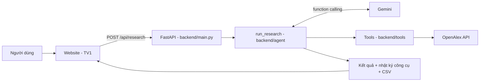

[README.md](https://github.com/user-attachments/files/34691324/README.md)
# PaperScout AI

Website hỗ trợ sinh viên **tìm và sàng lọc bước đầu tài liệu nghiên cứu khoa học**. Người dùng nhập chủ đề, khoảng năm, số bài cần tìm và tiêu chí bổ sung. Một AI Agent (Gemini) tự chọn từ khóa và công cụ, lấy **bài báo thật từ OpenAlex**, đọc tiêu đề và tóm tắt để gắn nhãn mức độ liên quan, rồi trả bảng kết quả có đường dẫn nguồn, nhật ký công cụ đã dùng và file CSV.

Nguyên tắc cốt lõi: **không bịa dữ liệu**. Tên bài, tác giả, năm, DOI, abstract chỉ đến từ OpenAlex qua code. Gemini chỉ được trả mã bài (`paper_id`), nhãn và lý do.

> **Về file này.** Đây là bản README khởi tạo do phần backend viết để cả nhóm định hướng và biết còn thiếu gì. README là phần của TV5, nên TV5 có thể viết lại hoặc bổ sung cho đủ 12 mục bắt buộc (xem mục 7.3).
> Trạng thái ghi theo cây thư mục ngày 10/11/2026. Muốn kiểm tra lại: `git ls-files`.

## Mục lục

1. [Hệ thống hoạt động thế nào](#1-hệ-thống-hoạt-động-thế-nào)
2. [Bản đồ thư mục: muốn làm gì thì mở file nào](#2-bản-đồ-thư-mục-muốn-làm-gì-thì-mở-file-nào)
3. [Chạy thử backend trong 5 phút](#3-chạy-thử-backend-trong-5-phút)
4. [Hợp đồng API](#4-hợp-đồng-api)
5. [Quy tắc làm việc chung](#5-quy-tắc-làm-việc-chung)
6. [Việc cần làm theo từng người](#6-việc-cần-làm-theo-từng-người)
7. [Giới hạn đã biết](#7-giới-hạn-đã-biết)
8. [Nguồn tham khảo](#8-nguồn-tham-khảo)

---

## 1. Hệ thống hoạt động thế nào



Một lần chạy diễn ra như sau:

1. Website gửi yêu cầu (`topic`, `year_from`, `year_to`, `num_papers`, `criteria`, `language`) tới `POST /api/research`.
2. Gemini đọc yêu cầu và **tự quyết định** gọi công cụ nào, với từ khóa gì. Mỗi lần gọi đều kèm một câu `rationale` giải thích vì sao.
3. Code thực thi công cụ, kiểm tra tham số, lọc năm, loại trùng, rồi trả kết quả thật về cho Gemini.
4. Gemini đọc tiêu đề và abstract, gắn nhãn từng bài (`Relevant`, `Possibly Relevant`, `Not Relevant`, `Insufficient Information`) kèm lý do.
5. Nếu chưa đủ bài `Relevant`, Gemini tự đổi từ khóa hoặc mở rộng từ một bài tốt. Tối đa **3 lượt tìm** để giữ trong hạn mức miễn phí. Khi đủ hoặc hết lượt, Gemini gọi `finish_research`.
6. Code tính trạng thái cuối (`completed`, `partial`, `error`), ghép metadata gốc và trả kết quả. Nếu thiếu bài, hệ thống báo đúng số lượng thực tế.

Bốn công cụ Gemini được gọi: `search_papers`, `find_related_papers`, `record_screening`, `finish_research`.


## 2. Bản đồ thư mục: muốn làm gì thì mở file nào

```
PaperScout-AI/
├── backend/
│   ├── main.py              FastAPI: 4 endpoint
│   ├── config.py            Đọc cấu hình từ .env
│   ├── requirements.txt     Thư viện chạy (đã ghim phiên bản)
│   ├── requirements-dev.txt Thêm pytest
│   ├── agent/
│   │   ├── research_agent.py  Vòng lặp agent, hàm run_research()
│   │   ├── instructions.py    Lệnh hệ thống cho Gemini, nạp tiêu chí
│   │   ├── schemas.py         Cấu trúc dữ liệu vào/ra (Pydantic)
│   │   ├── tool_registry.py   Khai báo 4 công cụ, kiểm tra, thực thi
│   │   ├── state.py           Trạng thái một lần chạy
│   │   ├── llm.py             Gọi Gemini (retry, giãn cách)
│   │   └── run_logger.py      Ghi nhật ký JSONL, che API key
│   └── tools/
│       ├── search.py          Gọi OpenAlex
│       ├── processing.py      Chuẩn hóa, lọc năm, loại trùng
│       └── export.py          Xuất CSV
├── frontend/                  (TV1) trống
├── evaluation/                (TV4) trống
├── docs/                      (TV5) trống
├── tests/                     Test chạy offline
├── scripts/                   Công cụ hỗ trợ (xem dưới)
├── demo/
│   ├── logs/                  3 nhật ký chạy thật
│   ├── sample_result.json     Kết quả mẫu (dùng làm dữ liệu giả cho giao diện)
│   └── sample_results.csv     CSV mẫu
├── .env.example               Tên biến môi trường (không chứa key)
└── pytest.ini
```

| Muốn... | Mở |
|---|---|
| Hiểu agent chạy từng bước | `python scripts/show_log.py demo/logs/e29b2bbd33a4.jsonl` (in dòng thời gian dễ đọc) |
| Xem agent đổi từ khóa và dùng `find_related_papers` | `python scripts/show_log.py demo/logs/398069570191.jsonl` (chủ đề hẹp, dùng đủ 3 lượt) |
| Xem agent giữ đúng khoảng năm | `python scripts/show_log.py demo/logs/f06d72185141.jsonl` (giới hạn 2025 đến 2026) |
| Xem JSON mẫu để code giao diện | `demo/sample_result.json` |
| Đổi cách Agent suy nghĩ, từ khóa, quy tắc dừng | `backend/agent/instructions.py` |
| Đổi tiêu chí sàng lọc (không cần sửa code) | `evaluation/screening_criteria.md` |
| Thêm hoặc sửa công cụ | `backend/agent/tool_registry.py` và `backend/tools/` |
| Đổi cấu trúc JSON trả về | `backend/agent/schemas.py` (báo TV1 và TV5 trước khi đổi) |
| Đổi giới hạn lượt tìm, số bước | biến `MAX_SEARCHES`, `MAX_MODEL_STEPS` trong `.env` |

Công cụ trong `scripts/`:

| Script | Tác dụng | Tốn quota? |
|---|---|---|
| `list_models.py` | Liệt kê model Gemini dùng được | Không |
| `check_connection.py` | Thử kết nối Gemini và function calling | Có (nhỏ) |
| `check_openalex.py` | Thử kết nối OpenAlex | Có (nhỏ) |
| `live_demo.py` | Chạy 3 yêu cầu thật qua Agent | **Có** |
| `baseline_script.py` | Bản không phải agent (từ khóa cố định) để so sánh | **Có** |
| `show_log.py` | In nhật ký chạy dễ đọc | Không |
| `scan_secrets.py` | Quét rò rỉ key trước khi push | Không |
| `verify_clean_clone.py` | Kiểm tra repo clone sạch cài đặt và chạy được | Không |

---

## 3. Chạy thử backend trong 5 phút

Cần Python 3.10 trở lên (đã kiểm tra trên 3.10).

```bash
# 1. Tạo môi trường ảo và cài thư viện
python -m venv .venv
# Windows:   .venv\Scripts\activate
# macOS/Linux: source .venv/bin/activate
pip install -r backend/requirements-dev.txt

# 2. Tạo file cấu hình
cp .env.example .env        # Windows: copy .env.example .env
```

Mở `.env` và điền 3 biến bắt buộc:

| Biến | Lấy ở đâu |
|---|---|
| `GEMINI_API_KEY` | Google AI Studio (aistudio.google.com/apikey), miễn phí |
| `GEMINI_MODEL` | Chạy `python scripts/list_models.py` rồi chọn một model hỗ trợ `generateContent`. Bản demo dùng `gemini-3.5-flash` |
| `OPENALEX_API_KEY` | Tài khoản miễn phí tại openalex.org, mục settings/api. OpenAlex hiện **yêu cầu API key**, không còn dùng `mailto` |

```bash
# 3. Chạy server (từ thư mục gốc repo)
uvicorn backend.main:app --reload
# Mở http://127.0.0.1:8000/docs để thử API ngay trên trình duyệt

# 4. Chạy test (offline, không cần key)
pytest
```

Chưa có key vẫn chạy được `pytest` và mở `/docs`. Gọi `POST /api/research` khi thiếu cấu hình sẽ nhận lỗi 503 nói rõ biến nào còn thiếu.

Chi tiết hơn (biến môi trường, triển khai Render): xem `backend/README.md`.

---

## 4. Hợp đồng API

Dành cho TV1 (nối giao diện) và TV5 (viết test). **Xin báo trước nếu cần đổi tên trường.**

### Các endpoint

| Endpoint | Việc |
|---|---|
| `POST /api/research` | Nhận yêu cầu, chạy Agent (đồng bộ), trả kết quả đầy đủ |
| `GET /api/runs/{run_id}` | Lấy lại kết quả đã lưu của một lần chạy (gồm `tool_history`) |
| `GET /api/exports/{run_id}` | Tải CSV (`text/csv`, tên file `paperscout_{run_id}.csv`) |
| `GET /health` | Kiểm tra backend và cấu hình (không lộ key) |

### Yêu cầu gửi lên (`POST /api/research`)

```json
{
  "topic": "large language models for education",
  "year_from": 2025,
  "year_to": 2026,
  "num_papers": 6,
  "criteria": "ưu tiên nghiên cứu thực nghiệm",
  "language": "vi"
}
```

| Trường | Quy tắc |
|---|---|
| `topic` | Bắt buộc, 3 đến 300 ký tự sau khi bỏ khoảng trắng đầu cuối |
| `year_from`, `year_to` | Tùy chọn. Từ 1900 đến năm hiện tại cộng 1. `year_from` không được lớn hơn `year_to` |
| `num_papers` | 1 đến 30, mặc định 10 |
| `criteria` | Tùy chọn, tối đa 1000 ký tự |
| `language` | `"vi"` hoặc `"en"` (mặc định `"vi"`). Là ngôn ngữ của phần lý do |

### Kết quả trả về (rút gọn, xem đầy đủ ở `demo/sample_result.json`)

```json
{
  "run_id": "e29b2bbd33a4",
  "status": "completed",
  "message": "...",
  "selected_ids": ["W3169509062"],
  "selected": [
    {
      "metadata": {
        "paper_id": "W3169509062",
        "title": "...",
        "authors": ["..."],
        "year": 2021,
        "doi": "https://doi.org/...",
        "source_url": "https://doi.org/...",
        "abstract": "... hoặc null",
        "source": "openalex"
      },
      "label": "Relevant",
      "reason": "..."
    }
  ],
  "label_counts": {"Relevant": 16, "Possibly Relevant": 1, "Not Relevant": 0, "Insufficient Information": 8},
  "searches_used": 1,
  "queries": ["machine learning medical image diagnosis"],
  "tool_history": [
    {"step": 1, "tool": "search_papers", "rationale": "...", "status": "ok", "summary": "...", "latency_ms": 1873}
  ],
  "errors": [],
  "terminated_by": "model_finish"
}
```

### Quy ước cần nhớ

- **`status`:** `completed` (đủ bài `Relevant`), `partial` (thiếu, vẫn có kết quả), `error` (không có lượt tìm nào thành công hoặc Gemini lỗi). **Cả ba đều là HTTP 200**, giao diện đọc trường `status`.
- **`selected`** gồm các bài `Relevant`, sau đó `Possibly Relevant`, cắt ở `num_papers`. `completed` chỉ tính bài `Relevant`. Bài `Not Relevant` và `Insufficient Information` không nằm trong `selected` nhưng vẫn được đếm trong `label_counts`.
- **CSV** chỉ chứa các bài trong `selected`.
- **Đừng phân tích chuỗi `message`** (nội dung có thể đổi). Dùng `status`, `label_counts`, `selected`.
- **`abstract` có thể là `null`, `doi` có thể là `null`.** Giao diện cần hiển thị được trường hợp thiếu. `source_url` luôn có.
- **Màn hình Agent Activity:** dùng `tool_history` (mỗi phần tử gồm `tool`, `rationale`, `summary`, `status`). Trường `args` có thể rất dài (ví dụ `record_screening` chứa cả danh sách nhãn), đừng hiển thị thô.
- **Thời gian:** một lần chạy trong 3 lần demo mất từ khoảng 25 giây đến khoảng 80 giây. Nên đặt timeout phía giao diện **từ 3 phút trở lên**.
- **Mã lỗi HTTP:** `422` nhập sai (kèm `detail` và danh sách `errors[{field, message}]`), `429` máy chủ đang bận một lần chạy khác (tối đa chờ 90 giây), `503` thiếu cấu hình máy chủ, `500` lỗi không lường trước. Các lỗi này đều trả JSON có `detail`.
- **CORS:** chỉ các địa chỉ trong biến `ALLOWED_ORIGINS` mới gọi được API từ trình duyệt. Khi có URL website của TV1, báo để thêm vào.

---

## 5. Quy tắc làm việc chung

**Git**
- Làm việc trên nhánh riêng, mở pull request vào `main`. Không push thẳng vào `main`.
- Thêm file bằng đường dẫn cụ thể (`git add <đường dẫn>`), tránh `git add .` hoặc `git add -A`.
- Trước khi push, chạy `python scripts/scan_secrets.py`.

**Bảo mật**
- **Không đưa lên GitHub:** `.env`, API key, `.venv/`, `node_modules/`, thư mục `logs/` và `runs/`.
- Không dán key vào chat, tài liệu hay ảnh chụp màn hình. Nếu lỡ lộ, xóa key và tạo key mới.
- `.env.example` chỉ chứa tên biến, giá trị để trống.

**Quota (gói miễn phí)**
- Mỗi yêu cầu thật tốn lượt gọi Gemini và OpenAlex. Các script tốn quota đã đánh dấu ở mục 3.
- Muốn thử giao diện, dùng `demo/sample_result.json` làm dữ liệu giả thay vì gọi API thật liên tục.

---

## 6. Việc cần làm theo từng người

### 6.1 TV1: giao diện (thư mục `frontend/`)

- [ ] Tạo giao diện Lovable gồm: form nhập yêu cầu, màn hình tiến trình Agent, bảng kết quả, nút Export CSV.
- [ ] Bảng kết quả hiển thị: tên bài, tác giả, năm, DOI, abstract, mức độ liên quan, lý do. Có liên kết mở `source_url`.
- [ ] Xử lý đủ các trạng thái: đang chạy, `completed`, `partial` (thông báo số bài thực tế), `error`, lỗi 422 (chỉ ra trường sai), 429, 503.
- [ ] Hiển thị được bài thiếu abstract hoặc thiếu DOI.
- [ ] Màn hình Agent Activity đọc từ `tool_history`.
- [ ] Nút Export CSV gọi `GET /api/exports/{run_id}`.
- [ ] Khi chưa có backend để gọi, dùng `demo/sample_result.json` làm dữ liệu mẫu. Khi nối thật, chạy backend ở máy (`uvicorn backend.main:app`) và trỏ giao diện vào `http://127.0.0.1:8000`.
- [ ] Gửi URL website cho người phụ trách backend để thêm vào `ALLOWED_ORIGINS`.
- [ ] Đưa ảnh chụp vào `demo/screenshots/`.

### 6.2 TV4: tiêu chí và đánh giá (thư mục `evaluation/`)

**`screening_criteria.md`: file này thay đổi hành vi Agent**
- Agent nạp **nguyên văn** nội dung file này vào lệnh hệ thống mỗi lần chạy. Đổi file là đổi cách gắn nhãn, không cần sửa code.
- Bốn nhãn phải viết **đúng chính tả** như sau: `Relevant`, `Possibly Relevant`, `Not Relevant`, `Insufficient Information`.
- Nên viết ngắn (một đến hai trang), nêu rõ điều kiện cho từng nhãn, ví dụ minh họa, luật biên. Cần chốt: bài **thiếu abstract** thì gắn nhãn gì, phân biệt `Relevant` và `Possibly Relevant` thế nào, và khi người dùng nêu tiêu chí bổ sung mà bài vi phạm thì xử lý ra sao.
- Có thể viết bằng tiếng Anh, tiếng Việt hoặc song ngữ.

**`research_queries.csv`:** 5 yêu cầu thử. Gợi ý cột khớp với API để dùng trực tiếp: `id, topic, year_from, year_to, num_papers, criteria, scenario`. Năm tình huống: phổ biến, hẹp, nhiều bài gần nghĩa, giới hạn năm chặt, nhiều điều kiện bổ sung.

**`evaluation_results.csv`:** gợi ý cột `run_id, query_id, paper_id, doi, title, agent_label, reference_label, match, metadata_ok, duplicate, notes`. Dùng `paper_id` (mã OpenAlex, ví dụ `W3169509062`) làm khóa đối chiếu vì nó ổn định giữa các lần chạy. Mỗi lần chạy có `GET /api/runs/{run_id}` để lấy lại kết quả.

**Đối chiếu dữ liệu:** kiểm tra bài có thật, DOI, năm, tên bài khớp với nguồn. Ghi lại cả những ca Agent phân loại sai.

### 6.3 TV5: tài liệu và kiểm thử (thư mục `docs/`, `tests/test_report.md`, README)

**Kiểm thử chức năng.** Gợi ý cách thử từng ca khi có backend:

| Ca | Cách thử | Kết quả mong đợi |
|---|---|---|
| TC01 | Gửi yêu cầu hợp lệ | Nhận `run_id`, Agent chạy |
| TC02 | `topic` rỗng | 422, thông báo trường `topic` |
| TC03 | `year_from` lớn hơn `year_to` | 422, thông báo `year_from must be <= year_to` |
| TC04 | Chủ đề phổ biến, `num_papers` nhỏ | `status: completed` |
| TC05 | Chủ đề hẹp, `num_papers` lớn | `status: partial`, `queries` có nhiều hơn một truy vấn |
| TC06 | Đặt tạm `OPENALEX_API_KEY` sai trong `.env` cục bộ | `status: error`, có `errors`, không bị treo |
| TC07 | Xem kết quả | Không có `paper_id` hay DOI trùng nhau trong `selected` |
| TC08 | Tìm bài thiếu abstract | `abstract` là `null`, không bị điền |
| TC09 | `GET /api/exports/{run_id}` | Tải được CSV, mở bằng Excel đúng tiếng Việt |
| TC10 | Xem `tool_history` | Khớp với nhật ký thật trong `logs/{run_id}.jsonl` |

Ghi Pass/Fail kèm ảnh chụp hoặc log vào `tests/test_report.md`. Lỗi giao diện gửi TV1, lỗi Agent hoặc backend gửi người phụ trách backend.

**Tài liệu cần làm:** `docs/requirements.pdf`, `docs/architecture.png`, `docs/agent_workflow.png`, `docs/demo_script.md`, `demo/demo_video_link.md`.

**README gốc cần đủ 12 mục.** Đối chiếu với file này:

| # | Mục | Đã có trong file này? |
|---|---|---|
| 1 | Project Overview | Có phần giới thiệu ngắn |
| 2 | Problem & Objectives | Chưa |
| 3 | Main Features | Chưa đầy đủ |
| 4 | AI Agent Architecture | Có sơ đồ và mô tả (mục 1) |
| 5 | Technology Stack | Chưa (Lovable, Python, Gemini, OpenAlex, FastAPI) |
| 6 | Project Structure | Có (mục 3) |
| 7 | Installation & Setup | Có phần backend (mục 4), thiếu frontend |
| 8 | How to Run | Có phần backend, thiếu frontend |
| 9 | Demo & Example Output | Mới có file mẫu, thiếu link website và ảnh |
| 10 | Testing & Evaluation | Chưa có kết quả đánh giá |
| 11 | Limitations | Có (mục 8) |
| 12 | Team Contributions & References | Chưa. Xem mục 9 về nguồn tham khảo |

---

## 7. Giới hạn đã biết

- Chất lượng nhãn là phán đoán của Gemini, **chưa có bộ đánh giá đối chiếu** (phần của TV4).
- Quy tắc "không có abstract thì không gắn `Relevant`" hiện chỉ nằm trong lệnh hệ thống, chưa được code ép cứng.
- Bản so sánh Agent với baseline (`scripts/baseline_script.py`) **chưa chạy thật**, nên chưa có bảng đối chứng.
- Một lần chạy mất vài chục giây đến khoảng hai phút. Chỉ chạy một yêu cầu tại một thời điểm (các yêu cầu khác chờ tối đa 90 giây rồi nhận 429).
- Gói miễn phí của Gemini và OpenAlex có hạn mức theo model, theo ngày. Khi gặp 429 hoặc 503, hệ thống thử lại tối đa ba lần rồi trả `status: error`.
- Trên Render gói miễn phí, ổ đĩa là tạm thời (mất `runs/` và `logs/` khi khởi động lại), máy chủ ngủ khi nhàn rỗi nên lần gọi đầu có thể chậm.
- Nội dung bài báo là dữ liệu không tin cậy. Lệnh hệ thống dặn Agent bỏ qua mọi chỉ dẫn nằm trong tiêu đề hoặc abstract.

---

## 8. Nguồn tham khảo

- Repository tham khảo: Islam Salahuddin, *Academic Online Research Agent* (github.com/IslamSalahuddin/academic-online-research-agent). Nhóm tham khảo cách tổ chức mã theo lớp (trạng thái tách khỏi vòng lặp điều phối, tiêm phụ thuộc, pipeline xử lý metadata, xuất CSV) và cách dựng lại abstract từ `abstract_inverted_index` của OpenAlex. Nhóm **không** dùng kiến trúc BDI của repo gốc: quyết định tìm kiếm trong PaperScout do Gemini function calling thực hiện. Vòng lặp agent, tool registry, các chốt chặn, nhật ký, FastAPI và bộ kiểm thử do nhóm tự xây dựng.
- OpenAlex API: developers.openalex.org
- Gemini API (function calling): ai.google.dev/gemini-api/docs/function-calling
- Phân công và họ tên thành viên: *(TV5 điền ở mục "Team Contributions")*
